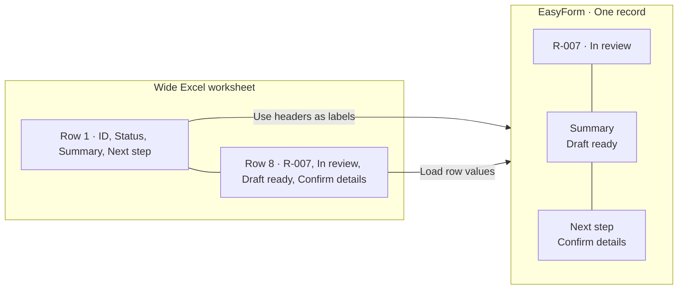
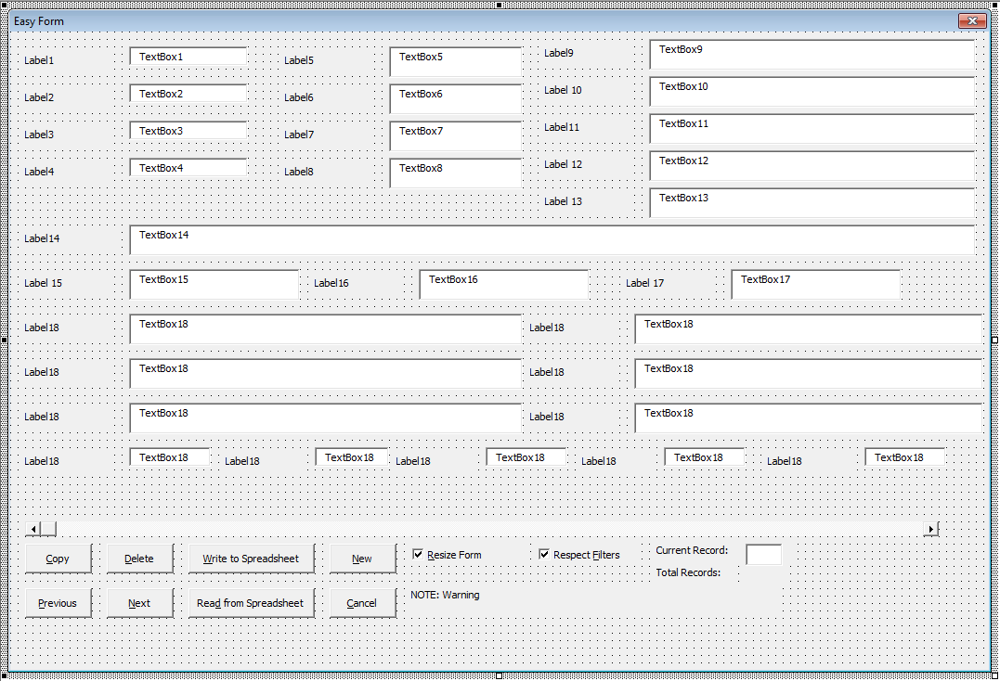
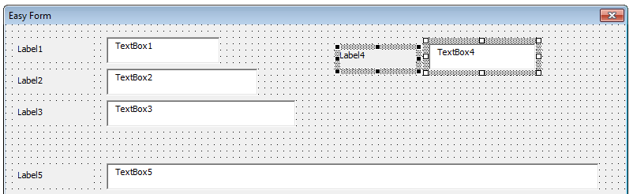
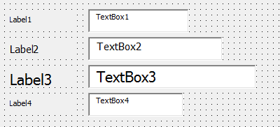
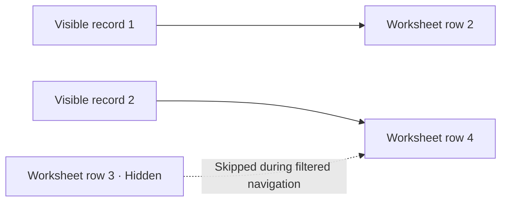

# EasyForm

**A configurable Excel/VBA record editor for wide, text-heavy spreadsheets.** I developed EasyForm during a 2011 placement with the Ontario Ministry of Health's Ontario Public Health Integrated Solutions (OPHIS) team.

During review meetings, staff had to scroll across wide worksheets to piece together a single record. Narrowing the columns made paragraphs harder to read. I built a modeless form that brought a record's fields into one view, let staff arrange those fields around how they worked, and kept the source worksheet available for direct editing.

### From worksheet row to record view

The diagram uses synthetic field names to illustrate how one worksheet row became a compact review form.

## What I built

*Original screenshot from the November 2011 user guide. The designer view shows the blank layout and the commands available when reviewing a record.*

| Area | Recovered capability |
| --- | --- |
| Record review | A modeless VBA UserForm displayed one worksheet row at a time. Excel remained available alongside the form. Textboxes could be sized for multi-line content and configured with scrollbars in the designer. |
| Navigation | Previous and Next buttons, a record-position scrollbar, a current/total display, and a clickable record number for direct entry. Later snapshots distinguish the visible-record count from the total count. The latest direct-jump path has a refresh defect. |
| Worksheet refresh | **Read** pulled changes from the active worksheet and recomputed the field count, headings, records, and navigation state. |
| Schema discovery | The form used row 1 for field labels and detected the last populated header. Generic routines loaded and wrote fields using numbered label/textbox pairs. |
| Layout customization | Staff could move, resize, and duplicate control pairs in the visual designer and save the layout with the workbook. Adaptive sizing could hide unused fields, reposition the controls below them, and warn when the form lacked enough pairs. |
| Field presentation | Each textbox could have its own font size, dimensions, and scrolling settings. In new-record mode the form dimmed the record counters, then restored their normal colour on return to browsing. |
| Existing records | **Write** transferred form values to the worksheet. **Copy** appended form values at the end. **Delete** asked for confirmation before removing an entire row. These are historical write paths with data-safety limitations. |
| New records | A separate **New** state cleared the form and changed which actions were available. **Cancel** returned to existing-record mode. An earlier snapshot contains a complete append branch. The latest snapshot has an insertion regression. |
| Filtered review | A **Respect Filters** option let navigation count and resolve visible worksheet rows, including rows hidden manually. Later versions introduced a visible-position-to-row lookup. Some write and delete handlers retained incompatible row calculations. |
| Workbook integration | The Ribbon package had **Easy Forms**, **Edit layout**, **Help**, and **About** commands. The editor launched from the workbook, which also stored its layout. A blank template and a tailored layout survive in the archive. |

*Moving a field pair in the visual designer.*

*The 2011 guide shows how to set the font size for an entire field.*

## Scope and limitations

- **Table shape.** The intended setup was one conventional table with headers on row 1 and a continuous populated first column. Gaps can truncate counting or misplace appends. Layout changes depend on correctly named, ordered control pairs. The workbook has one shared form layout.
- **Editing semantics.** The form writes textbox values into cells and can remove whole rows. It can overwrite formulas, and **Copy** appends values without cloning the source row's formatting. The recovered editor lacks reliable unsaved-change prompts and an undo action. Switching the active worksheet while the form is open can change which data it targets.
- **Record identity.** In later snapshots, filtered navigation and mutations can disagree on the target row. **Write** or **Delete** on a filtered table can affect the wrong row. In the latest build, direct jump can leave a stale display, and the new-record insertion gate can reject populated forms.
- **Scale.** Counting and visible-row lookup scan worksheet rows, and many position variables use VBA's 16-bit `Integer`. Large worksheets can encounter overflow or slow refreshes.
- **Formatting scope.** Whole-field styling was configurable in the form designer. The guide explicitly excludes mixed formatting within a textbox, such as bold or italics on selected words. Automatically matching worksheet cell colours was a proposed enhancement, alongside multiple layouts per workbook, global navigation shortcuts, and zoom.
- **Historical outcome.** The archive records a November handoff, a guide, and prepared templates. Adoption after handoff and measured time savings remain unverified.

## Using a recovered workbook

The archive preserves original workbooks and extracted VBA. The workbook carries the form designer state and Excel integration needed for historical testing.

The November 2011 guide reports testing in **Excel 2007 and Excel 2010 for Windows**. The `.xlsm` template offered Ribbon shortcuts. The guide also described a separate `.xls` workflow for Excel 2003 and earlier using Excel's macro menu.

On a compatible desktop Excel setup, the historical workflow was to open an authorized disposable copy under local macro policy, put a synthetic table on the intended worksheet, launch **Easy Forms** from the Ribbon, and use **Read** after worksheet edits. **Edit layout** opened or pointed users to the VBA designer, where the numbered control pairs could be arranged. Use disposable data for any write-path testing.

## How the design evolved

| Recovered milestone | What changed |
| --- | --- |
| **v0.1 to v0.2 · October 14** | A fixed ten-field prototype moved toward header-driven field discovery and generic control loops. Some ten-field checks still remained while the new routines took over display and writeback. |
| **v0.3 to v0.5a · October 19–20** | `PullFromSheet` collected refresh steps into a common path. `ResizeForm` combined the earlier hide and reposition features. Later work counted the form's available controls as well as the worksheet's columns. |
| **v0.5b to v0.6b · October 20–21** | I split creation from editing, added the copy and cancel paths, and guarded the scrollbar against events triggered by programmatic updates. |
| **v0.7 to v0.8a · late October to early November** | Template branches experimented with filtering. Dedicated lookup routines split visible record position from the physical worksheet row. |
| **v0.8e · recovered November 17** | The legacy workbook preserved the late navigation and validation work. Some write paths still used the old indexing assumptions or lost an earlier validation result. |

### Why filtering changed the design

With contiguous rows, the record number could double as a worksheet position. Filtering separated those concepts. This synthetic example shows why a write operation needs the same resolved row as the record display.

That indexing change crossed navigation, counts, refresh, and mutations. The recovered code captures the design challenge: display and write paths need to agree on record identity even when the user changes how the sheet is viewed.

EasyForm drew on Contextures' Excel form example, Ron de Bruin's Ribbon guidance, Chip Pearson's colour utilities and designer guidance, and OzGrid discussions on visible rows. My contribution was adapting those techniques into a configurable record-review workflow for the team.
