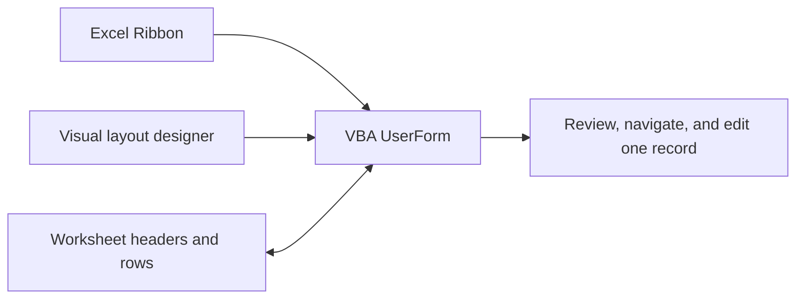

# EasyForm

**An Excel/VBA record editor for wide, text-heavy spreadsheets.** I developed EasyForm during a 2011 placement with the Ontario Ministry of Health's Ontario Public Health Integrated Solutions (OPHIS) team.

In review meetings, the team had to scroll across wide worksheets to piece together a single record. Narrowing columns made paragraphs harder to read. I built a form that showed one record at a time and let staff arrange fields around how they reviewed the data. They could keep using the worksheet and open the form directly from the Excel Ribbon.

## What I built

| Feature | How it worked |
| --- | --- |
| Record review | A modeless VBA UserForm displayed one worksheet row at a time. Staff could move between records with buttons, a scrollbar, or a record-number jump, and refresh the form after worksheet edits. |
| Configurable layouts | Staff could resize and reposition numbered label and textbox pairs in Excel's visual designer. The form read titles and field count from the header row, then hid surplus controls and resized to fit. |
| Record editing | The form supported writing back existing records, copying textbox values to a new row, and deleting records. Earlier builds contained a new-record workflow whose write path regressed in later snapshots. |
| Filter-aware navigation | Later versions added a mode for navigating visible records while rows were filtered or hidden. The recovered code shows working design concepts for counts and row lookup, with unresolved inconsistencies in how write and delete operations selected their target rows. |
| Workbook integration | Ribbon commands opened the form, layout designer, and help. The archive preserves a blank template and a tailored layout, along with the user guide and handoff presentation. |

## How the design evolved

My first prototype displayed ten fixed fields. I replaced field-by-field code with loops over numbered controls, using the worksheet header to determine how many fields to display. This made layout changes possible in the visual designer without editing VBA. The same workbook stored both the data and the customized layout.

As the form grew, I consolidated repeated refresh steps into a shared routine that updated counts, field labels, record values, and scrollbar state. I also gave the new-record workflow its own editing state so the interface could distinguish creating a record from updating the one already displayed.

Filtering changed a core assumption. The third visible record could be on worksheet row twelve, so the interface needed to track visible position separately from physical row. I added visible-row lookup and a guard for programmatic scrollbar updates. Some mutation handlers still used a different row calculation. That inconsistency is the clearest technical lesson in the recovered code.

| Period | Recovered milestones |
| --- | --- |
| Mid-October 2011 | Fixed ten-field prototype, followed by dynamic field discovery and configurable layouts. |
| Late October 2011 | Shared refresh logic, adaptive form sizing, separate new and cancel states, and the first filter experiments. |
| November 2011 | Visible-row navigation, event guards, a legacy XLS copy, and the November 18 handoff presentation. |

The project drew on Contextures' Excel form example, Ron de Bruin's Ribbon guidance, Chip Pearson's colour utilities and designer guidance, and OzGrid discussions on visible rows. My contribution was adapting these techniques into a configurable record-review workflow for the team.

## Historical status

The surviving source and documents establish the workflows above. Colour matching, multiple independently configured forms per workbook, and global navigation shortcuts were proposed. The archive records a handoff and a historical compatibility claim. Adoption, measured time savings, and compatibility with current Excel remain unverified.

## Using a recovered workbook

If you have an authorized copy of a recovered workbook, use a disposable copy in desktop Excel for Windows with synthetic data.

1. Put one table on a worksheet, with the column titles in row 1 and one record per row.
2. Open the workbook under your organization's macro policy and select **Easy Form** on the Ribbon.
3. Browse records or select **Read** to refresh after a worksheet edit.
4. To customize the layout, use **Edit Layout** or the VBA designer. Keep label and textbox names paired by number. Save the layout with the workbook.

The workbook contains the UserForm and Ribbon integration. Extracted module text alone cannot recreate the application. The latest recovered build has a filtered-delete row targeting risk and an incomplete insertion path. Use disposable data for any write-path testing.
